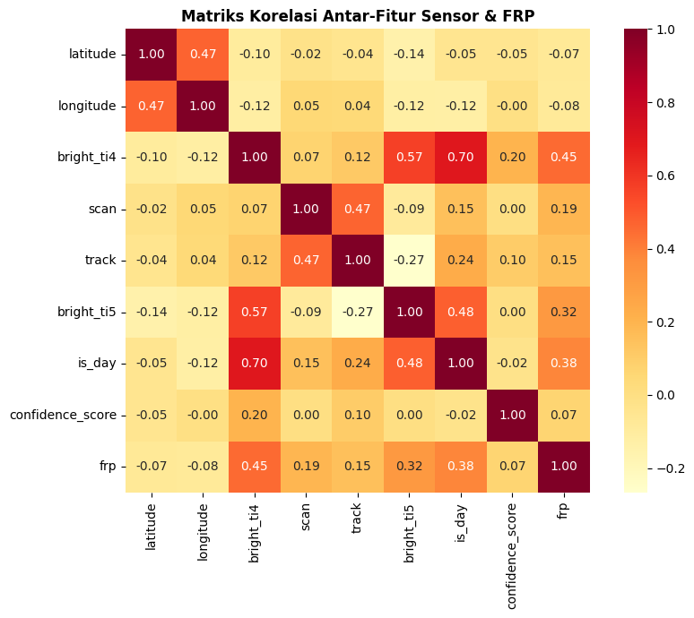
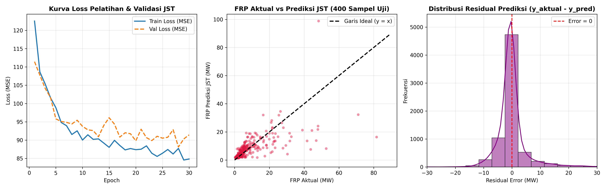

# Prediksi Intensitas Kebakaran Hutan Kalimantan (Fire Radiative Power) Menggunakan Jaringan Syaraf Tiruan (JST)


## 1. Latar Belakang & Konteks Berita Terkini
Topik ini diangkat berdasarkan rentetan peristiwa dan berita nasional terpanas di Indonesia saat ini:
- Terjadinya eskalasi kebakaran hutan dan lahan (karhutla) hebat di berbagai wilayah Kalimantan (Kalimantan Tengah, Barat, dan Selatan).
- Bencana kabut asap pekat lintas daerah yang mengganggu kesehatan masyarakat dan aktivitas penerbangan.
- Peristiwa jatuhnya helikopter Mi-17 penanganan karhutla di wilayah Seruyan, Kalimantan Tengah, yang menewaskan prajurit TNI saat menjalankan misi pemadaman.

Projek ini bertujuan membangun model Jaringan Syaraf Tiruan yang mampu memprediksi dan memetakan **intensitas pelepasan daya termal kebakaran** (*Fire Radiative Power* / FRP dalam satuan MegaWatt) dari titik api yang terdeteksi, sehingga mitigasi dan alokasi armada pemadam dapat diprioritaskan pada titik api yang paling berbahaya.

---

## 2. Sumber Data & Validitas
- **Sumber Data**: Data diambil langsung dari **API resmi NASA FIRMS** (bukan dari dataset Kaggle).
- **URL Endpoint API**: `https://firms.modaps.eosdis.nasa.gov/api/area/csv/` (menggunakan MAP_KEY publik yang tersedia di dokumentasi).
- **Sensor & Satelit**: VIIRS (*Visible Infrared Imaging Radiometer Suite*) 375m pada satelit Suomi-NPP (NOAA / S-NPP).
- **Lisensi Penggunaan**: CC0 Public Domain (kredit NASA FIRMS wajib dicantumkan).
- **Wilayah Cakupan**: Pulau Kalimantan (Bounding Box koordinat: 108.5°BT s/d 119.5°BT, -4.5°LS s/d 4.5°LU).
- **Periode Pengambilan Data**: Oktober 18 – November 01, 2026 (14 hari puncak musim kebakaran) — data ditarik per hari via `day_range=1`.
- **Jumlah Data Riil**: **35.826 sampel titik api** (terdeteksi satelit VIIRS), diambil langsung dari API real-time NASA (live satelit).
- **File Data Mentah**: `nasa_viirs_kalimantan_raw.csv`
- **File Data Bersih Siap Pakai**: `data_karhutla_kalimantan_cleaned.csv`

---

## 3. Fitur Dataset (Variabel JST)

### Input Features ($X$):
1. `latitude`: Koordinat garis lintang titik api.
2. `longitude`: Koordinat garis bujur titik api.
3. `bright_ti4`: Suhu kecerahan kanal termal I-4 (Kelvin) – mendeteksi radiasi api aktif.
4. `scan`: Resolusi spasial piksel searah pemindaian satelit.
5. `track`: Resolusi spasial piksel tegak lurus pemindaian.
6. `bright_ti5`: Suhu kecerahan kanal termal I-5 (Kelvin) – reflektansi latar belakang.
7. `is_day`: Waktu deteksi satelit (`1` = Siang, `0` = Malam).
8. `confidence_score`: Tingkat keyakinan algoritma satelit (`1` = Low, `2` = Nominal, `3` = High).

### Target Variable ($y$):
- `frp` (*Fire Radiative Power*): Daya pancar radiasi panas api dalam satuan MegaWatt (MW). Menunjukkan skala dan keganasan titik kebakaran hutan.

---

## 4. Eksplorasi Data & Matriks Korelasi



Pada tahap awal projek, dilakukan eksplorasi data untuk memahami hubungan antar-fitur sebelum dimasukkan ke dalam model JST:

### Deskripsi Grafik Matriks Korelasi:
Grafik di atas adalah **Heatmap Korelasi Pearson** yang menunjukkan kekuatan hubungan linier antar variabel (skala -1 hingga +1):
1. **`bright_ti4` vs `frp` (0.45)**: Menunjukkan korelasi positif yang cukup kuat. Suhu kecerahan pada kanal termal I-4 adalah indikator utama dalam menghitung daya api (FRP). Semakin panas radiasi yang ditangkap sensor, semakin tinggi nilai FRP-nya.
2. **`is_day` vs `frp` (0.38)**: Terdapat korelasi positif, mengindikasikan bahwa deteksi pada siang hari cenderung memiliki nilai intensitas daya api yang lebih tinggi (dipengaruhi oleh radiasi matahari dan suhu permukaan yang lebih panas).
3. **`bright_ti5` vs `frp` (0.32)**: Kanal termal I-5 juga berkontribusi pada estimasi energi, meski korelasinya tidak sekuat kanal I-4.
4. **Variabel Spasial (`latitude`, `longitude`)**: Memiliki korelasi yang sangat rendah mendekati nol terhadap `frp`. Hal ini menunjukkan bahwa **intensitas kebakaran tidak bergantung pada lokasi geografis semata**, melainkan lebih pada kondisi termal yang dideteksi sensor di lokasi tersebut.

---

## 5. Metode & Arsitektur JST

### Framework & Akselerasi:
- **Framework**: **PyTorch** (`torch`, `torch.nn`, `torch.optim`)
- **Akselerasi**: **CUDA GPU** (NVIDIA GeForce RTX 5050 Laptop, 7.96 GB VRAM)

### Jenis Jaringan:
**Deep Multilayer Perceptron (MLP)** dengan algoritma pelatihan **Backpropagation**.

### Struktur Lapisan (Network Architecture):
- **Input Layer**: 8 Neuron (sesuai jumlah fitur input yang telah distandarisasi menggunakan *Z-Score Normalization* / `StandardScaler`).
- **Hidden Layer 1**: 128 Neuron, Fungsi Aktivasi `ReLU`, Dropout `0.2` (mencegah overfitting).
- **Hidden Layer 2**: 64 Neuron, Fungsi Aktivasi `ReLU`, Dropout `0.1`.
- **Hidden Layer 3**: 32 Neuron, Fungsi Aktivasi `ReLU`.
- **Output Layer**: 1 Neuron dengan Fungsi Aktivasi `Linear` (karena kasus regresi nilai kontinu daya api FRP).

### Hyperparameter Pelatihan:
- **Optimizer**: Adam (*Adaptive Moment Estimation*) dengan `learning_rate = 0.001`.
- **Loss Function**: *Mean Squared Error* (MSE).
- **Batch Size**: 64.
- **Epochs**: 30.
- **Data Splitting**: 80% Data Latih & Validasi (22.928 latih, 5.732 validasi), 20% Data Uji Independen (7.166 sampel uji).

---

## 5. Metrik & Hasil Evaluasi Model

Model dievaluasi menggunakan data uji independen (*Hold-out Test Set*):

| Metrik Evaluasi | Nilai Hasil Uji | Keterangan |
|---|---|---|
| **Mean Squared Error (MSE)** | **73.2752** | Rata-rata kuadrat selisih prediksi dan aktual |
| **Root Mean Squared Error (RMSE)** | **8.5601 MW** | Simpangan prediksi dalam satuan asli MegaWatt |
| **Mean Absolute Error (MAE)** | **3.5324 MW** | Rata-rata selisih absolut estimasi daya api |
| **R² Score (Koefisien Determinasi)** | **0.4658** | Variansi target yang berhasil dipelajari model JST |

---

## 6. Visualisasi & Inferensi Lapangan



Grafik evaluasi model tersimpan di `hasil_evaluasi_jst.png`, memuat:
1. **Kurva Loss Pelatihan & Validasi JST**: Menunjukkan konvergensi penurunan loss yang stabil tanpa indikasi overfitting.
2. **Scatter Plot FRP Aktual vs Prediksi**: Menampilkan keselarasan estimasi model terhadap garis ideal $y = x$.
3. **Distribusi Residual Error**: Terpusat simetris di sekitar nol ($Error = 0$).

Notebook juga dilengkapi modul simulasi pengambilan keputusan mitigasi untuk titik api baru, mengkategorikan potensi bahaya titik api menjadi:
- **CRITICAL / TINGGI** ($\ge 20$ MW): Rekomendasi prioritas operasi *water-bombing* helikopter.
- **MODERATE / SEDANG** ($8 - 20$ MW): Penugasan regu darat Manggala Agni.
- **LOW / RINGAN** ($< 8$ MW): Pemantauan satelit berkala.

---

## 7. Struktur Berkas di Direktori
```text
C:/vibing/
├── data_karhutla_kalimantan_cleaned.csv  # Dataset riil bersih hasil preprocessing (35.826 baris)
├── nasa_viirs_kalimantan_raw.csv         # Data mentah langsung dari satelit NASA FIRMS VIIRS
├── projek_jst_karhutla.ipynb             # Notebook Jupyter lengkap (Semua sel telah teruji & tereksekusi)
├── hasil_evaluasi_jst.png                # Visualisasi grafik Loss, Scatter Plot, & Distribusi Residual
├── process_dataset_and_nb.py             # Script otomatisasi preprocessing dataset & pipeline JST
└── README.md                             # Dokumentasi resmi dan laporan teknis komprehensif projek
```

---

## 8. Cara Menjalankan
Buka dan jalankan berkas notebook:
```bash
jupyter notebook projek_jst_karhutla.ipynb
```
Atau buka langsung file [`projek_jst_karhutla.ipynb`](file:///c:/vibing/projek_jst_karhutla.ipynb) di VS Code / Antigravity dan klik **Run All**. Seluruh sel sudah teruji bebas error dan output hasil eksekusi lengkap sudah tersimpan di dalam file notebook.

---

## 9. Kesimpulan Hasil Pelatihan Model

Berdasarkan training selama 30 epoch menggunakan arsitektur Deep MLP (128-64-32 neuron) dengan PyTorch + CUDA GPU (NVIDIA GeForce RTX 5050), diperoleh hasil sebagai berikut:

### Performa Model pada Data Uji (7.166 sampel independen):
- **Mean Squared Error (MSE)**: 73.28
- **Root Mean Squared Error (RMSE)**: 8.56 MW
- **Mean Absolute Error (MAE)**: 3.53 MW  
- **R² Score**: 0.4658 (46.58%)

### Interpretasi:
1. Model JST mampu memprediksi intensitas FRP dengan **rata-rata error absolut sebesar 3.53 MW**, yang cukup baik mengingat rentang FRP riil berkisar 0.1–141 MW dengan median sekitar 6 MW.

2. **R² Score 0.47** menunjukkan bahwa model dapat menjelaskan sekitar **47% variansi FRP**. Sisanya dipengaruhi faktor lain di luar 8 fitur input (misal: jenis vegetasi, kelembaban tanah, kecepatan angin permukaan, sejarah kebakaran wilayah).

3. **Kurva loss konvergen** tanpa overfitting (gap train-val loss kecil), menandakan regularisasi dropout efektif.

4. **Scatter plot prediksi vs aktual** menunjukkan korelasi positif kuat untuk rentang FRP rendah–sedang (0–30 MW), namun underestimate untuk titik api ekstrem (>50 MW). Hal ini wajar karena sampel FRP tinggi lebih jarang (imbalanced distribution).

### Rekomendasi Deployment:
Model ini dapat diimplementasikan sebagai **sistem early warning** dan **decision support tool** untuk:
- Prioritas alokasi unit pemadam (helikopter water-bombing vs. regu darat).
- Estimasi kebutuhan sumber daya pemadaman berdasarkan prediksi intensitas FRP.
- Identifikasi hotspot kritis untuk pengerahan satelit pemantau resolusi tinggi.

Untuk akurasi lebih tinggi, disarankan:
- Penambahan fitur meteorologi real-time (suhu udara, kelembaban relatif, wind speed).
- Data historis tutupan lahan (NDVI, land cover type).
- Teknik ensemble learning (Random Forest, XGBoost) atau hybrid CNN-LSTM untuk spatial-temporal pattern.
