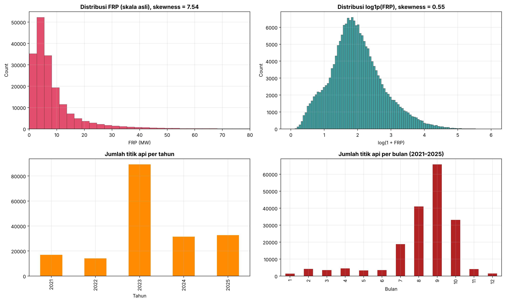

# Prediksi Intensitas Kebakaran Hutan Kalimantan (Fire Radiative Power) Menggunakan Jaringan Syaraf Tiruan (JST)

## 1. Latar Belakang & Konteks Berita Terkini
Topik ini diangkat berdasarkan rentetan peristiwa dan berita nasional terpanas di Indonesia saat ini:
- Terjadinya eskalasi kebakaran hutan dan lahan (karhutla) hebat di berbagai wilayah Kalimantan (Kalimantan Tengah, Barat, dan Selatan).
- Bencana kabut asap pekat lintas daerah yang mengganggu kesehatan masyarakat dan aktivitas penerbangan.
- Peristiwa jatuhnya helikopter Mi-17 penanganan karhutla di wilayah Seruyan, Kalimantan Tengah, yang menewaskan prajurit TNI saat menjalankan misi pemadaman.

Projek ini bertujuan membangun model Jaringan Syaraf Tiruan yang mampu memprediksi **intensitas pelepasan daya termal kebakaran** (*Fire Radiative Power* / FRP dalam satuan MegaWatt) dari titik api yang terdeteksi satelit, sehingga mitigasi dan alokasi armada pemadam dapat diprioritaskan pada titik api yang paling berbahaya.

---

## 2. Sumber Data & Pipeline

| Langkah | Skrip | Keluaran |
|---|---|---|
| 1. Titik api VIIRS S-NPP 2021–2025 dari arsip tahunan resmi NASA FIRMS (Indonesia), dipotong ke Kalimantan (108,5°–119,5° BT, −4,5°–4,5° LU/LS) | `fetch_hotspots.py` | `nasa_viirs_kalimantan_raw.csv` (193.106 deteksi) |
| 2. Cuaca harian NASA POWER (MERRA-2) per sel grid 0,5°: suhu, kelembapan, hujan, angin, kelembapan tanah, VPD | `fetch_weather.py` | `daily_weather.csv`, `grid_cells.csv` |
| 3. Gabung titik api + cuaca, fitur lag 1/3/7/14/30 hari (hanya hari **sebelum** deteksi) | `build_features.py` | `data_karhutla_dengan_cuaca.csv` |
| 4. Pembersihan, rekayasa fitur, pelatihan & evaluasi | `projek_jst_karhutla.ipynb` | model, tabel, grafik |

- **Lisensi**: data NASA FIRMS dan NASA POWER terbuka (kredit NASA wajib dicantumkan).
- **File data besar tidak disimpan di branch ini.** Ambil dari branch **`datamentah`** (Git LFS) atau buat ulang dengan menjalankan tiga skrip di atas secara berurutan.

### Pembersihan data
- **Hanya kebakaran vegetasi** (`type == 0`). Arsip FIRMS juga memuat 8.130 sumber panas statis/industri (`type == 2`) dan 519 deteksi lepas pantai (`type == 3`) yang bukan karhutla.
- **FRP < 500 MW** (2 deteksi ekstrem dibuang).
- Hasil: **184.455 titik api** pada 1.671 hari (2.918 overpass satelit), 3 Januari 2021 – 31 Desember 2025.

| Tahun | Titik api | Median FRP (MW) | Rata-rata FRP (MW) | Porsi CRITICAL (≥ 20 MW) |
|---|---|---|---|---|
| 2021 | 16.966 | 5,50 | 8,85 | 8,3% |
| 2022 | 14.090 | 5,52 | 8,77 | 8,7% |
| 2023 | 89.215 | 5,47 | 8,94 | 8,8% |
| 2024 | 31.514 | 6,10 | 10,54 | 11,6% |
| 2025 | 32.670 | 6,40 | 10,86 | 13,0% |

### Catatan kualitas data sensor
- Kanal I4 (`bright_ti4`) memiliki rentang 208–367 K. **6.275 piksel (3,4%) jenuh di 367 K**; median FRP-nya 13,85 MW, jauh di atas piksel lain (5,55 MW).
- **57 piksel bernilai 208 K** adalah kasus *fold-over*: api yang begitu panas sehingga nilai digital I4 "terlipat" dan tampak dingin (median FRP 95,2 MW). Piksel ini diberi flag dan diset ke 367 K.
- FRP produk 375 m dihitung dari kanal M13 (750 m) yang tidak ada di CSV FIRMS. Akibatnya piksel 375 m yang bersebelahan sering memiliki FRP identik, dan di atas titik saturasi fitur suhu tidak lagi membawa informasi intensitas.

---

## 3. Fitur Dataset (67 Fitur Masukan)

| Kelompok | Jumlah | Fitur |
|---|---|---|
| Sensor dasar | 8 | `latitude`, `longitude`, `bright_ti4`, `scan`, `track`, `bright_ti5`, `is_day`, `confidence_score` |
| Flag kualitas I4 | 2 | `ti4_folded` (208 K), `ti4_saturated` (≥ 367 K atau terlipat) |
| Termal & geometris | 7 | `delta_t`, `pixel_area` (FRP adalah daya total per piksel), `ti4_day`, `ti4_ti5_ratio`, `delta_t_day`, `conf_high`, `conf_nominal` |
| Waktu | 5 | `hour_frac`, `hour_sin`, `hour_cos` (jam akuisisi UTC), `doy_sin`, `doy_cos` (musim kemarau/hujan) |
| Kerapatan hotspot per overpass | 4 | `cell_density`, `neigh_density` (blok 3×3 sel 0,5°), `overpass_total`, `neigh_density_norm` |
| Klaster api (radius 0,5 & 1 km, overpass yang sama) | 11 | `mir_excess_area` (kelebihan radiansi MIR 3,74 µm × luas piksel), `nb_count`, `nb_max_ti4`, `nb_mean_ti4`, `nb_sat`, `nb_sum_excess` per radius |
| Cuaca lag (1, 3, 7, 14, 30 hari sebelumnya) | 30 | `precip_acc`, `rh_mean`, `temp_mean`, `wind_mean`, `soil_min`, `vpd_max` |

Tidak dipakai: cuaca **hari yang sama** (rata-rata harian mencakup jam setelah satelit lewat), `day_idx` (selalu di luar rentang data latih untuk tanggal baru), dan `month` (sudah terwakili `doy_sin`/`doy_cos`). Semua fitur kerapatan dan klaster hanya memakai deteksi pada overpass yang sama, sehingga tersedia begitu data satelit diterima.

**Target**: `frp` (MW), dilatih sebagai `log1p(frp)`.

---

## 4. Eksplorasi Data


- Korelasi Pearson `bright_ti4`–FRP hanya 0,31, tetapi korelasi peringkat (Spearman) **0,70**: hubungan monotonik kuat yang tertutupi distribusi FRP yang sangat menceng. Hal yang sama untuk `is_day` (0,23 vs 0,55) dan `bright_ti5` (0,23 vs 0,29).
- Fitur klaster api paling berkorelasi dengan FRP (Spearman `nb_mean_ti4_0.5km` 0,72), sedangkan fitur cuaca lag lemah (|Spearman| ≤ 0,14) karena resolusinya kasar (sel 0,5°, harian).



- **Median FRP 5,73 MW**, **mean 9,53 MW**, **maksimum 408,38 MW** (skewness 7,54; setelah `log1p` 0,55).
- Kebakaran sangat musiman (puncak Agustus–Oktober) dan 2023 (tahun El Niño) mendominasi data.
- Pada model JST final, **±1,4% sampel dengan error terbesar menyumbang 61,5% nilai MSE**.

---

## 5. Metode & Arsitektur JST

### Framework
**PyTorch** (`torch`, `torch.nn`, `torch.optim`), CUDA bila tersedia. Output yang tersimpan di notebook dijalankan di CPU.

### Pembagian Data (tanpa kebocoran)
Satu kebakaran terdeteksi sebagai banyak piksel bersebelahan dalam satu overpass, dan piksel tetangga sering memiliki FRP identik. Dengan split acak, **16,6%** titik uji punya tetangga di data latih dengan FRP persis sama. Karena itu data dibagi per **kelompok = overpass × sel grid 0,5°** (35.360 kelompok): **118.625 latih, 30.427 validasi, 35.403 uji**; piksel kembar di data uji tinggal **0,4%**. Generalisasi ke tahun baru diuji terpisah (latih 2021–2023, validasi 2024, uji 2025).

### Arsitektur Final (hasil tuning)
- **Input**: 67 neuron (distandarisasi `StandardScaler` yang di-*fit* pada data latih).
- **Hidden**: 512 → 256 → 128 neuron, masing-masing `BatchNorm1d` → `Tanh` → Dropout (0,2 / 0,1 / 0,05).
- **Output**: 1 neuron linear → `log1p(FRP)`.
- **Parameter**: 200.961 per model; model JST final = **ensemble 5 seed**.

### Pelatihan
- **Loss**: MSE pada ruang `log1p(FRP)`; **optimizer** AdamW (lr 0,002, weight decay 1e-4); **batch** 512.
- **Scheduler**: `ReduceLROnPlateau` (faktor 0,5, patience 10); **early stopping** patience 30, maksimum 300 epoch.
- **Pasca-pemrosesan**: batas atas keluaran `log1p(FRP maks data latih)` dan **kalibrasi isotonic** pada data validasi (MSE validasi 165,01 → 148,20).

### Hyperparameter Tuning Bertahap
Dibandingkan pada data validasi (kriteria: MSE validasi ruang `log1p`), anggaran sama untuk setiap percobaan (maks. 80 epoch, patience 15). Hasil lengkap: `hasil_tuning_jst.csv`.

| Tahap | Konfigurasi | Val MSE (log) |
|---|---|---|
| A. Aktivasi (256-128-64) | ReLU / GELU / SiLU / **Tanh** | 0,22503 / 0,22721 / 0,22661 / **0,22441** |
| B. Arsitektur (Tanh) | 128-64-32 / 256-128-64 / **512-256-128** | 0,22455 / 0,22441 / **0,22380** |
| C. Learning rate (batch 512) | 3e-4 / 1e-3 / **2e-3** | 0,22469 / 0,22380 / **0,22243** |
| C. Batch size (lr 1e-3) | **512** / 1024 | **0,22380** / 0,22388 |

Selisih antar-konfigurasi kecil (±2%): informasi pada fitur lebih menentukan daripada arsitektur.

### Pembanding
Baseline konstan (rata-rata data latih), regresi linear pada `log1p(FRP)` + isotonic, **XGBoost `reg:tweedie`**, dan **ensemble JST + XGBoost** dengan bobot dipilih di data validasi.

---

## 6. Hasil Evaluasi

Seluruh angka berasal dari **data uji berkelompok (35.403 titik)** yang tidak dipakai untuk pelatihan, tuning, kalibrasi, maupun pemilihan model.

### 6.1 Perbandingan Model

| Model | MSE | RMSE (MW) | MAE (MW) | R² | R² (skala log) |
|---|---|---|---|---|---|
| Baseline: rata-rata data latih | 160,23 | 12,66 | 7,16 | 0,000 | −0,241 |
| Baseline: regresi linear (log1p) + isotonic | 126,60 | 11,25 | 5,24 | 0,210 | 0,533 |
| JST ensemble 5 seed + isotonic | 104,09 | 10,20 | 4,64 | 0,350 | 0,630 |
| XGBoost (tweedie) | 100,26 | 10,01 | 4,47 | 0,374 | 0,638 |
| **Ensemble JST 0,60 + XGBoost 0,40 (model final)** | **99,14** | **9,96** | **4,50** | **0,381** | **0,642** |

- Model final dipilih berdasarkan MSE validasi terkecil (145,98); JST memegang bobot terbesar.
- **Stabilitas JST antar-seed**: R² 0,342 ± 0,010; MAE 4,680 ± 0,025 MW.
- Median error absolut JST: 2,10 MW.

### 6.2 Studi Ablasi: Dari Desain Tahap 1 ke JST Final


| Langkah | MSE | MAE (MW) | R² | R² (log) |
|---|---|---|---|---|
| 1. Desain Tahap 1 (8 fitur, ReLU 128-64-32, Adam, MSE FRP mentah, 30 epoch) | 107,61 | 4,82 | 0,328 | 0,554 |
| 2. + target log1p, LR scheduler & early stopping | 113,23 | 4,51 | 0,293 | 0,593 |
| 3. + kalibrasi isotonic | 110,31 | 5,07 | 0,311 | 0,541 |
| 4. + 18 fitur turunan & arsitektur hasil tuning | 110,75 | 5,05 | 0,309 | 0,548 |
| 5. + 11 fitur klaster api | 106,55 | 4,73 | 0,335 | 0,616 |
| 6. + 30 fitur cuaca lag (1 seed) | 104,33 | 4,66 | 0,349 | 0,624 |
| **7. + ensemble 5 seed (JST final)** | **104,09** | **4,64** | **0,350** | **0,630** |

- **Fitur klaster api** adalah perbaikan terbesar (langkah 4 → 5); **fitur cuaca lag** menambah lagi (langkah 5 → 6).
- Desain Tahap 1 punya MSE cukup rendah karena langsung mengoptimasi MSE pada FRP mentah, tetapi R² skala log-nya jauh di bawah JST final.
- Kalibrasi isotonic menurunkan MSE tetapi menaikkan MAE (langkah 2 → 3), karena prediksi digeser ke arah rata-rata.

Tabel lengkap: `hasil_ablasi_jst.csv`.

### 6.3 Kebocoran Split & Generalisasi ke Tahun Baru

Validasi silang XGBoost (67 fitur, skor gabungan *out-of-fold*):

| Skema evaluasi | R² | R² (skala log) | MAE (MW) |
|---|---|---|---|
| KFold acak 5-fold (bocor) | 0,413 | 0,677 | 4,28 |
| **GroupKFold 5-fold (overpass × sel 0,5°)** | **0,369** | **0,629** | **4,66** |
| *Forward-chaining* per tahun (latih tahun sebelumnya, uji 2022–2025) | 0,243 | 0,509 | 5,64 |

**Uji tahun baru** (latih 2021–2023, validasi 2024, uji 2025, 32.670 titik): JST R² 0,202 (MAE 6,96 MW), XGBoost R² 0,212 (MAE 6,58 MW). Memprediksi tahun yang belum pernah dilihat jauh lebih sulit, apalagi FRP 2025 lebih tinggi daripada 2021–2023.

### 6.4 Performa per Band Intensitas FRP (Model Final)

| Band FRP | n Sampel | Proporsi | MAE (MW) | RMSE (MW) | Bias (MW) |
|---|---|---|---|---|---|
| LOW (< 8 MW) | 23.191 | 65,5% | 2,260 | 3,495 | +1,939 |
| MODERATE (8–20 MW) | 8.758 | 24,7% | 4,412 | 5,940 | +1,447 |
| CRITICAL (≥ 20 MW) | 3.454 | 9,8% | 19,742 | 29,063 | −17,465 |
| **Seluruh test** | **35.403** | **100%** | **4,498** | **9,957** | **−0,076** |

### 6.5 Status Mitigasi & Ambang Alarm CRITICAL

| Aturan | Recall CRITICAL | Presisi CRITICAL | Titik ditandai CRITICAL | Akurasi 3 kelas |
|---|---|---|---|---|
| Ambang tetap 20 MW | 38,5% | 51,4% | 7,3% | 70,5% |
| **Ambang alarm dituning di validasi (13,76 MW)** | **67,9%** | **33,7%** | **19,6%** | **66,4%** |

Dengan ambang 13,76 MW, sekitar 2 dari 3 titik api CRITICAL tertangkap, dengan konsekuensi sekitar 2 dari 3 alarm ternyata bukan CRITICAL. Kompromi ini wajar bila melewatkan api besar jauh lebih mahal daripada alarm palsu.

---

## 7. Visualisasi & Simulasi Mitigasi


`hasil_evaluasi_jst.png` memuat kurva loss (seed 42, early stopping di epoch 72), scatter FRP aktual vs prediksi JST (R² 0,350), distribusi residual (median −0,89 MW), dan error per band.

Simulasi memakai hari dengan titik api terbanyak pada 2025 (**24 September 2025**). Titik contoh diperlakukan sebagai deteksi pada overpass hari itu (fitur kerapatan & klaster dihitung ulang bersama deteksi overpass tersebut), cuaca lag diambil dari deteksi terdekat pada tanggal yang sama, dan `acq_time` memakai jam overpass S-NPP dalam UTC. Kategori: **CRITICAL** (≥ 13,76 MW, prioritas *water-bombing*), **MODERATE** (8–13,76 MW, regu darat Manggala Agni), **LOW** (< 8 MW, pemantauan satelit).

| Lokasi | `bright_ti4` | `acq_time` (UTC) | Prediksi FRP | Rekomendasi |
|---|---|---|---|---|
| Katingan (Hutan Gambut Pekat) | 365,2 K | 06:05 | 31,80 MW | CRITICAL — Water Bombing Helikopter |
| Seruyan (Dekat Pemukiman) | 342,1 K | 06:25 | 13,04 MW | MODERATE — Tim Manggala Agni Darat |
| Ketapang (Titik Api Malam) | 324,6 K | 17:50 | 5,67 MW | LOW — Pemantauan Satelit Berkala |

---

## 8. Struktur Berkas
```text
.
├── fetch_hotspots.py                         # 1. unduh titik api VIIRS 2021–2025 (NASA FIRMS)
├── fetch_weather.py                          # 2. unduh cuaca harian NASA POWER per sel 0,5°
├── build_features.py                         # 3. gabung titik api + cuaca, fitur lag
├── projek_jst_karhutla.ipynb                 # 4. notebook utama (semua sel tereksekusi)
├── requirements.txt                          # dependensi Python
├── hasil_tuning_jst.csv                      # tabel hyperparameter tuning
├── hasil_ablasi_jst.csv / .png               # studi ablasi Tahap 1 → JST final
├── hasil_evaluasi_jst.png                    # loss, scatter, residual, error per band
├── matriks_korelasi_fitur.png                # korelasi fitur sensor
├── distribusi_frp_dan_waktu.png              # distribusi FRP & pola tahunan/bulanan
├── Dokumen_Tahap_1_Karhutla_Kalimantan.docx  # dokumen Tahap 1
├── Laporan_Prediksi_Karhutla_Kalimantan.docx # draf paper
└── README.md
```
Data (`nasa_viirs_kalimantan_raw.csv`, `daily_weather.csv`, `grid_cells.csv`, `data_karhutla_dengan_cuaca.csv`) ada di branch **`datamentah`** dan diabaikan git di branch ini.

---

## 9. Cara Menjalankan
```bash
pip install -r requirements.txt
# Data: salin CSV dari branch `datamentah`, atau buat ulang:
python fetch_hotspots.py
python fetch_weather.py
python build_features.py
jupyter notebook projek_jst_karhutla.ipynb
```
Notebook membutuhkan `data_karhutla_dengan_cuaca.csv` (dan `nasa_viirs_kalimantan_raw.csv` bila kolom `type` belum ada di file cuaca) di folder yang sama.

Satu kali *Run All* memakan waktu sekitar **55 menit di CPU** (2 core); sebagian besar untuk hyperparameter tuning (±20 menit), ensemble 5 seed (±16 menit), dan studi ablasi. Untuk memakai hasil tersimpan (`hasil_tuning_jst.csv`, `hasil_ablasi_jst.csv`) tanpa melatih ulang, ubah `RUN_TUNING = False` dan `RUN_ABLATION = False` di sel pertama. Di GPU jauh lebih cepat.

---

## 10. Kesimpulan

1. **Model final** (ensemble JST 0,60 + XGBoost 0,40) mencapai MSE 99,14, MAE 4,50 MW, dan R² 0,381 pada data uji berkelompok. **JST sendiri** mencapai R² 0,350 dan MAE 4,64 MW, jauh di atas regresi linear (R² 0,210), dan sedikit di bawah XGBoost (R² 0,374).
2. **Fitur klaster api** adalah perbaikan terbesar; **fitur cuaca lag** dari NASA POWER menambah akurasi lebih lanjut.
3. **Tuning** memilih Tanh 512-256-128 (lr 0,002, batch 512), dengan selisih antar-konfigurasi hanya ±2%.
4. **Evaluasi jujur penting**: split acak terlalu optimistis (R² XGBoost 0,413 vs 0,369 GroupKFold), dan memprediksi tahun baru jauh lebih sulit (R² ±0,2 untuk uji 2025).
5. **Untuk mitigasi**, ambang alarm 13,76 MW menangkap 67,9% titik api CRITICAL.

### Batasan & Arah Pengembangan
- FRP dihitung dari kanal M13 yang tidak ada di CSV FIRMS dan 3,4% piksel I4 jenuh, sehingga kelas CRITICAL masih *underestimate* (bias −17,5 MW).
- Cuaca NASA POWER berresolusi kasar (0,5°, harian); korelasinya dengan FRP per piksel lemah.
- Distribusi FRP bergeser antar-tahun (2023 El Niño; FRP 2024–2025 lebih tinggi).
- Pengembangan: deteksi NOAA-20/NOAA-21, peta gambut & tutupan lahan, riwayat FRP per lokasi, model spasial–temporal.

---

## Catatan Revisi

**Revisi 1 (audit)** — versi awal (data 15 hari) memakai split acak yang bocor. Diperbaiki: split berkelompok, penanganan piksel I4 terlipat/jenuh, kerapatan per overpass tanpa `day_idx`, ambang alarm CRITICAL.

**Revisi 2 (Tahap 2)** — fitur klaster api, hyperparameter tuning bertahap, ensemble 5 seed, pembanding baseline, studi ablasi.

**Revisi 3 (data 2021–2025 + cuaca)** — data & pipeline baru (`fetch_hotspots.py`, `fetch_weather.py`, `build_features.py`) digabung dengan semua perbaikan di atas:
- Hanya kebakaran vegetasi (`type == 0`); `build_features.py` kini menyimpan kolom `type`.
- Hanya cuaca lag (hari sebelumnya); cuaca hari yang sama tidak dipakai.
- Uji tahun baru (latih 2021–2023, uji 2025) dan *forward-chaining* per tahun.
- Simulasi memakai tanggal nyata dengan jam overpass UTC yang realistis.
- `requirements.txt` ditambah `xgboost`.
