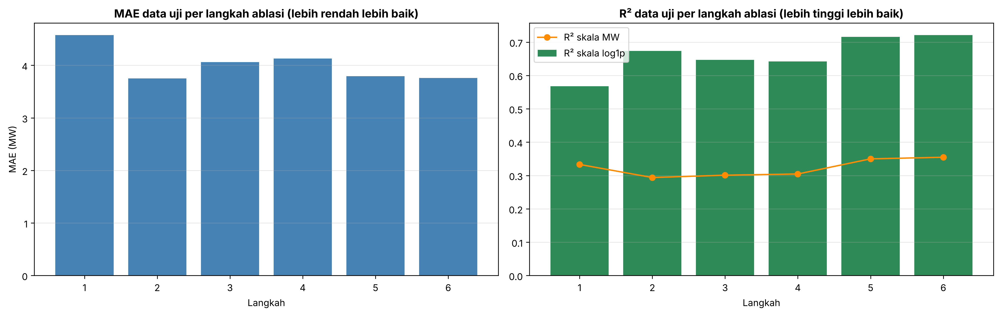

# Prediksi Intensitas Kebakaran Hutan Kalimantan (Fire Radiative Power) Menggunakan Jaringan Syaraf Tiruan (JST)

## 1. Latar Belakang & Konteks Berita Terkini
Topik ini diangkat berdasarkan rentetan peristiwa dan berita nasional terpanas di Indonesia saat ini:
- Terjadinya eskalasi kebakaran hutan dan lahan (karhutla) hebat di berbagai wilayah Kalimantan (Kalimantan Tengah, Barat, dan Selatan).
- Bencana kabut asap pekat lintas daerah yang mengganggu kesehatan masyarakat dan aktivitas penerbangan.
- Peristiwa jatuhnya helikopter Mi-17 penanganan karhutla di wilayah Seruyan, Kalimantan Tengah, yang menewaskan prajurit TNI saat menjalankan misi pemadaman.

Projek ini bertujuan membangun model Jaringan Syaraf Tiruan yang mampu memprediksi dan memetakan **intensitas pelepasan daya termal kebakaran** (*Fire Radiative Power* / FRP dalam satuan MegaWatt) dari titik api yang terdeteksi, sehingga mitigasi dan alokasi armada pemadam dapat diprioritaskan pada titik api yang paling berbahaya.

---

## 2. Sumber Data & Validitas
- **Sumber Data**: Data diambil langsung dari **API resmi NASA FIRMS** (bukan dari dataset Kaggle).
- **URL Endpoint API**: `https://firms.modaps.eosdis.nasa.gov/api/area/csv/` (menggunakan MAP_KEY publik yang tersedia di dokumentasi).
- **Sensor & Satelit**: VIIRS (*Visible Infrared Imaging Radiometer Suite*) 375m pada satelit Suomi-NPP (NOAA / S-NPP).
- **Lisensi Penggunaan**: CC0 Public Domain (kredit NASA FIRMS wajib dicantumkan).
- **Wilayah Cakupan**: Pulau Kalimantan (Bounding Box koordinat: 108.5°BT s/d 119.5°BT, -4.5°LS s/d 4.5°LU).
- **Periode Pengambilan Data**: 18 Oktober – 01 November 2026 (**15 hari** puncak musim kebakaran, 29 overpass satelit) — data ditarik per hari via `day_range=1`.
- **Jumlah Data Riil**: **35.826 sampel titik api** (terdeteksi satelit VIIRS), diambil langsung dari API real-time NASA (live satelit).
- **File Data Mentah**: `nasa_viirs_kalimantan_raw.csv` (35.827 baris; satu baris FRP 529,28 MW dibuang saat *cleaning* sebagai outlier).
- **File Data Bersih**: `data_karhutla_kalimantan_cleaned.csv` (9 kolom sensor + target).
- **File Data Siap Latih**: `data_karhutla_fitur_siap_latih.csv` (35.826 baris, 35 fitur hasil preprocessing + `frp` + label `split` train/val/test), dihasilkan oleh notebook.

### Catatan kualitas data sensor
- Kanal I4 (`bright_ti4`) memiliki rentang 208–367 K. **1.185 piksel (3,3%) jenuh di 367 K**; median FRP-nya 16,4 MW, jauh di atas median piksel lain (3,5 MW).
- **10 piksel bernilai 208 K** adalah kasus *fold-over*: api yang begitu panas sehingga nilai digital I4 "terlipat" dan tampak dingin. FRP-nya 48–277 MW. Di notebook piksel ini diberi flag dan diset ke 367 K.
- FRP produk 375 m dihitung dari kanal M13 (750 m) yang tidak ada di CSV FIRMS. Akibatnya piksel 375 m yang bersebelahan sering memiliki FRP identik, dan di atas titik saturasi fitur suhu tidak lagi membawa informasi intensitas.

---

## 3. Fitur Dataset (Variabel JST)

Model memakai **35 fitur masukan**: 8 fitur sensor + 2 flag kualitas I4 + 7 fitur termal/geometris + 3 fitur waktu + 4 fitur kerapatan + 11 fitur klaster api.

### 3.1 Fitur Sensor Dasar (8)
1. `latitude`: Koordinat garis lintang titik api.
2. `longitude`: Koordinat garis bujur titik api.
3. `bright_ti4`: Suhu kecerahan kanal termal I-4 (Kelvin) – mendeteksi radiasi api aktif. Piksel terlipat (208 K) diset ke 367 K.
4. `scan`: Resolusi spasial piksel searah pemindaian satelit.
5. `track`: Resolusi spasial piksel tegak lurus pemindaian satelit.
6. `bright_ti5`: Suhu kecerahan kanal termal I-5 (Kelvin) – reflektansi latar belakang.
7. `is_day`: Waktu deteksi satelit (`1` = Siang, `0` = Malam).
8. `confidence_score`: Tingkat keyakinan algoritma satelit (`1` = Low, `2` = Nominal, `3` = High).

### 3.2 Flag Kualitas I4 (2)
| Fitur | Definisi | Alasan |
|---|---|---|
| `ti4_folded` | `bright_ti4 == 208 K` | Api ekstrem yang membuat nilai digital I4 terlipat |
| `ti4_saturated` | `bright_ti4 >= 367 K` atau terlipat | Suhu I4 tidak lagi mengukur intensitas |

### 3.3 Fitur Turunan Termal & Geometris (7)
| Fitur | Rumus | Alasan |
|---|---|---|
| `delta_t` | `bright_ti4 - bright_ti5` | Kontras suhu api terhadap latar (proksi energi radiasi) |
| `pixel_area` | `scan * track` | Luas piksel; FRP adalah daya total per piksel, jadi piksel lebih luas → FRP lebih besar |
| `ti4_day` | `bright_ti4 * is_day` | Interaksi suhu–waktu |
| `ti4_ti5_ratio` | `bright_ti4 / bright_ti5` | Kontras relatif terhadap kondisi latar |
| `delta_t_day` | `delta_t * is_day` | Kontras termal terkoreksi siang/malam |
| `conf_high` | `confidence_score == 3` | One-hot keyakinan deteksi tinggi |
| `conf_nominal` | `confidence_score == 2` | One-hot keyakinan nominal |

### 3.4 Fitur Temporal (3)
| Fitur | Alasan |
|---|---|
| `hour_frac` | Fraksi waktu akuisisi (UTC) dalam sehari (siklus diurnal memengaruhi radiasi terdeteksi) |
| `hour_sin`, `hour_cos` | Encoding siklik agar jam 23:59 dan 00:01 berdekatan |

`day_idx` tidak dipakai sebagai fitur karena untuk tanggal baru nilainya selalu di luar rentang data latih.

### 3.5 Fitur Kerapatan Hotspot (4)
Dihitung **per overpass** (tanggal UTC + siang/malam) dari koordinat saja (**tidak memakai target**). Semua informasi ini sudah tersedia begitu data satu lintasan satelit diterima, sehingga tidak ada informasi dari masa depan:
| Fitur | Alasan |
|---|---|
| `cell_density` | Jumlah hotspot di sel grid 0,5° pada overpass yang sama |
| `neigh_density` | Jumlah hotspot blok 3×3 sel (klaster kebakaran besar) |
| `overpass_total` | Total hotspot se-Kalimantan pada overpass tersebut (intensitas episode) |
| `neigh_density_norm` | Rasio klaster terhadap total overpass |

### 3.6 Fitur Klaster Api (11)
FRP produk 375 m dihitung dari piksel kanal M13 berukuran 750 m yang mencakup beberapa piksel 375 m sekaligus. Karena itu jumlah, suhu, dan status saturasi **piksel api tetangga** (radius 0,5 km dan 1 km, overpass yang sama, tanpa target) membawa informasi energi total api:
| Fitur | Definisi |
|---|---|
| `mir_excess_area` | Kelebihan radiansi MIR 3,74 µm (hukum Planck: `L(T_I4) − L(T_I5)`) × luas piksel |
| `nb_count_{r}km` | Jumlah piksel api lain dalam radius *r* |
| `nb_max_ti4_{r}km`, `nb_mean_ti4_{r}km` | Suhu I4 maksimum dan rata-rata di sekitar piksel (termasuk dirinya) |
| `nb_sat_{r}km` | Jumlah piksel jenuh/terlipat dalam radius *r* |
| `nb_sum_excess_{r}km` | `log(1 + Σ mir_excess_area)` dalam radius *r* |

### Target Variable ($y$)
- `frp` (*Fire Radiative Power*): Daya pancar radiasi panas api dalam satuan MegaWatt (MW), terintegrasi per piksel. Saat pelatihan ditransformasi menjadi `log1p(frp)`.

---

## 4. Eksplorasi Data & Matriks Korelasi


### Deskripsi Grafik Matriks Korelasi:
Heatmap **Korelasi Pearson** di atas menunjukkan kekuatan hubungan linier antar variabel (skala -1 hingga +1):
1. **`bright_ti4` vs `frp` (0.45)**: Korelasi positif cukup kuat. Suhu kecerahan kanal termal I-4 adalah indikator utama daya api (FRP). Karena FRP sangat menceng, korelasi peringkat (Spearman) jauh lebih tinggi: **0,83**.
2. **`is_day` vs `frp` (0.38; Spearman 0,65)**: Deteksi siang hari cenderung memiliki intensitas daya api lebih tinggi (puncak siklus harian kebakaran terjadi siang–sore).
3. **`bright_ti5` vs `frp` (0.32; Spearman 0,55)**: Kanal termal I-5 juga berkontribusi, meski tidak sekuat I-4.
4. **Variabel Spasial (`latitude`, `longitude`)**: Korelasi mendekati nol terhadap `frp` — intensitas kebakaran tidak ditentukan lokasi geografis semata, melainkan kondisi termal yang dideteksi sensor.

### Distribusi Target (dasar perbaikan model)
- **Median FRP 3,69 MW**, **mean 7,36 MW**, **maksimum 319,51 MW** → distribusi sangat *right-skewed*.
- Pada model final (data uji berkelompok), **±1,4% sampel dengan error terbesar menyumbang 77,9% nilai MSE**.
- Segmen **CRITICAL (≥ 20 MW)** hanya **7,5%** dari seluruh data (6,7% dari data uji).

Implikasi: loss MSE pada skala asli didominasi segelintir titik api ekstrem, sehingga model cenderung *underestimate* pada titik api besar.

---

## 5. Metode & Arsitektur JST

### Framework & Akselerasi:
- **Framework**: **PyTorch** (`torch`, `torch.nn`, `torch.optim`)
- **Akselerasi**: CUDA GPU bila tersedia, selain itu CPU. Output yang tersimpan di notebook saat ini dijalankan di CPU.

### Jenis Jaringan:
**Deep Multilayer Perceptron (MLP)** dengan algoritma pelatihan **Backpropagation**, dilengkapi `BatchNorm1d`.

### Struktur Lapisan (hasil tuning):
- **Input Layer**: 35 Neuron (distandarisasi dengan `StandardScaler`).
- **Hidden Layer 1**: 256 Neuron → `BatchNorm1d` → `SiLU` → Dropout `0.2`.
- **Hidden Layer 2**: 128 Neuron → `BatchNorm1d` → `SiLU` → Dropout `0.1`.
- **Hidden Layer 3**: 64 Neuron → `BatchNorm1d` → `SiLU` → Dropout `0.05`.
- **Output Layer**: 1 Neuron `Linear` → memprediksi `log1p(FRP)`.
- **Total parameter terlatih**: 51.329 bobot & bias per model; model final = **ensemble 5 seed**.

### Hyperparameter Pelatihan:
- **Optimizer**: AdamW (`learning_rate = 0.001`, `weight_decay = 1e-4`).
- **Loss Function**: *Mean Squared Error* pada ruang `log1p(FRP)`.
- **Learning Rate Scheduler**: `ReduceLROnPlateau` (faktor 0.5, patience 10).
- **Early Stopping**: patience 30 epoch, maksimum 300 epoch (seed 42 berhenti di **epoch 79**).
- **Batch Size**: 128.

### Hyperparameter Tuning Bertahap
Dibandingkan pada **data validasi** (kriteria: MSE validasi di ruang `log1p`); tiap tahap memakai pemenang tahap sebelumnya. Hasil lengkap di `hasil_tuning_jst.csv`.

| Tahap | Konfigurasi | Val MSE (log) |
|---|---|---|
| A. Aktivasi | ReLU / GELU / **SiLU** / Tanh (256-128-64) | 0,14807 / 0,14798 / **0,14601** / 0,14877 |
| B. Arsitektur | 128-64-32 / **256-128-64** / 512-256-128 / 256-256-128-64 | 0,14618 / **0,14601** / 0,14786 / 0,14654 |
| C. Learning rate (batch 128) | 3e-3 / **1e-3** / 3e-4 | 0,14740 / **0,14601** / 0,14651 |
| C. Batch size (lr 1e-3) | 64 / **128** / 512 | 0,14848 / **0,14601** / 0,14641 |

Selisih antar-konfigurasi kecil (< 2%), jadi arsitektur bukan hambatan utama; informasi pada fitur yang paling menentukan.

### Pembagian Data (tanpa kebocoran)
Satu kebakaran terdeteksi sebagai banyak piksel bersebelahan dalam satu overpass, dan piksel tetangga sering memiliki FRP identik. Dengan split acak, **29,6%** titik uji punya tetangga di data latih (overpass yang sama, median jarak 0,4 km) dengan FRP persis sama, sehingga skor uji terlalu optimistis.

Karena itu data dibagi per **kelompok = overpass × sel grid 0,5°** (1.514 kelompok); seluruh piksel dalam satu kelompok selalu berada di sisi yang sama. Hasilnya **24.228 latih, 4.869 validasi, 6.729 uji**, dan piksel kembar di data uji tinggal **0,4%**.

### Teknik Kunci:
1. **Target `log1p(FRP)`** — menstabilkan loss pada distribusi sangat menceng.
2. **Fitur klaster api** — informasi piksel api tetangga, penyumbang perbaikan terbesar.
3. **Penanganan piksel I4 terlipat & batas atas keluaran** — flag + set ke 367 K, dan keluaran log dibatasi `log1p(FRP maksimum data latih)`.
4. **Ensemble 5 seed** — rata-rata prediksi 5 JST dengan inisialisasi berbeda.
5. **Kalibrasi isotonic** — fungsi monotonik yang di-*fit* pada data **validasi** untuk mengoreksi bias `expm1` (prediksi mean terlalu rendah pada distribusi log-normal). MSE validasi turun dari 56,24 menjadi 49,39.
6. **Ambang alarm CRITICAL dituning di validasi** — ambang terbesar yang masih memberi recall CRITICAL ≥ 70% pada data validasi (hasil: **16,08 MW**).

---

## 6. Metrik & Hasil Evaluasi Model

Seluruh angka di bagian ini berasal dari **data uji berkelompok (6.729 sampel)** yang tidak pernah dilihat saat pelatihan, tuning, kalibrasi, maupun pemilihan model.

### 6.1 JST vs Pembanding

| Model | MSE | RMSE (MW) | MAE (MW) | R² | R² (skala log) |
|---|---|---|---|---|---|
| Baseline: rata-rata data latih | 188,79 | 13,74 | 6,42 | 0,000 | −0,287 |
| Baseline: regresi linear (log1p) + isotonic | 133,40 | 11,55 | 4,04 | 0,293 | 0,685 |
| XGBoost (tweedie) | 128,38 | 11,33 | 3,74 | 0,320 | 0,714 |
| **JST ensemble 5 seed + isotonic (model final)** | **121,81** | **11,04** | **3,76** | **0,355** | **0,721** |

Model final dipilih berdasarkan MSE validasi terkecil (49,39); pada ensemble JST + XGBoost, bobot XGBoost yang terpilih di validasi adalah 0. Median error absolut model final **1,05 MW**.

**Stabilitas antar-seed** (masing-masing dikalibrasi sendiri): R² **0,351 ± 0,009**, MAE **3,777 ± 0,018 MW**, MSE 122,52 ± 1,73.

### 6.2 Studi Ablasi: Dari Desain Tahap 1 ke Model Final



| Langkah | MSE | MAE (MW) | R² | R² (log) |
|---|---|---|---|---|
| 1. Desain Tahap 1 (8 fitur, ReLU 128-64-32, Adam, MSE FRP mentah, 30 epoch) | 125,89 | 4,57 | 0,333 | 0,568 |
| 2. + target log1p, LR scheduler & early stopping | 133,29 | 3,75 | 0,294 | 0,674 |
| 3. + kalibrasi isotonic | 131,96 | 4,06 | 0,301 | 0,647 |
| 4. + 16 fitur turunan & arsitektur hasil tuning | 131,29 | 4,13 | 0,305 | 0,642 |
| 5. + 11 fitur klaster api (1 seed) | 122,72 | 3,80 | 0,350 | 0,716 |
| **6. + ensemble 5 seed (JST final)** | **121,81** | **3,76** | **0,355** | **0,721** |

- **Fitur klaster api** adalah perbaikan terbesar (langkah 4 → 5).
- Desain Tahap 1 punya MSE lebih rendah daripada langkah 2–4 karena langsung mengoptimasi MSE pada FRP mentah, tetapi MAE-nya terburuk dan R² skala log terendah: loss itu memusatkan model pada segelintir api ekstrem.
- Model final terbaik pada MSE, R², dan R² skala log. MAE-nya setara dengan langkah 2 (3,76 vs 3,75 MW) karena kalibrasi isotonic menggeser prediksi ke arah rata-rata (MSE turun, MAE sedikit naik).

Tabel lengkap: `hasil_ablasi_jst.csv`.

### 6.3 Uji Ketahanan Skema Evaluasi

Satu holdout memiliki varians besar pada target yang sangat menceng, jadi skema evaluasi juga diuji dengan validasi silang XGBoost (35 fitur, skor gabungan *out-of-fold*):

| Skema evaluasi | R² | R² (skala log) | Recall CRITICAL (20 MW) |
|---|---|---|---|
| KFold acak 5-fold (bocor) | 0,570 | 0,81 | 52,2% |
| **GroupKFold 5-fold (overpass × sel 0,5°)** | **0,400** | **0,76** | **43,1%** |
| *Forward-chaining* per hari (latih hari < d, uji hari d = 6–14) | 0,386 | 0,73 | 22,9% |

Uji waktu (latih hari 0–9, validasi 10–11, uji 12–14): **JST R² 0,405** (recall CRITICAL 51,2%), XGBoost R² 0,426 (recall 32,2%).

### 6.4 Performa per Band Intensitas FRP (Model Final)

| Band FRP | n Sampel | Proporsi | MAE (MW) | RMSE (MW) | Bias (MW) |
|---|---|---|---|---|---|
| LOW (< 8 MW) | 5.111 | 76,0% | 1,566 | 2,903 | +1,210 |
| MODERATE (8–20 MW) | 1.166 | 17,3% | 5,047 | 6,443 | +1,817 |
| CRITICAL (≥ 20 MW) | 452 | 6,7% | 25,218 | 40,138 | −23,406 |
| **Seluruh test** | **6.729** | **100%** | **3,758** | **11,037** | **−0,338** |

### 6.5 Status Mitigasi & Ambang Alarm CRITICAL

| Aturan | Recall CRITICAL | Presisi CRITICAL | Titik ditandai CRITICAL | Akurasi 3 kelas |
|---|---|---|---|---|
| Ambang tetap 20 MW | 31,0% | 51,3% | 4,1% | 80,7% |
| **Ambang alarm dituning di validasi (16,08 MW)** | **66,2%** | **33,4%** | **13,3%** | **77,9%** |

Dengan ambang 16,08 MW, sekitar 2 dari 3 titik api CRITICAL tertangkap, dengan konsekuensi sekitar 2 dari 3 alarm ternyata bukan CRITICAL. Kompromi ini wajar bila melewatkan api besar jauh lebih mahal daripada alarm palsu.

---

## 7. Visualisasi & Inferensi Lapangan


Grafik evaluasi model tersimpan di `hasil_evaluasi_jst.png`, memuat:
1. **Kurva Loss Pelatihan & Validasi JST** (seed 42): early stopping di epoch 79.
2. **Scatter Plot FRP Aktual vs Prediksi**: keselarasan terhadap garis ideal $y = x$ (R² = 0,355, split berkelompok).
3. **Distribusi Residual Error**: median residual −0,34 MW.
4. **Error per Band Intensitas FRP**: MAE & RMSE untuk segmen LOW/MODERATE/CRITICAL.

Notebook juga dilengkapi modul simulasi pengambilan keputusan mitigasi untuk titik api baru. Titik api baru diperlakukan sebagai deteksi pada overpass terakhir (fitur kerapatan & klaster dihitung ulang bersama deteksi overpass itu), dan `acq_time` memakai jam overpass S-NPP yang realistis dalam UTC (siang ±04–07 UTC, malam ±16–19 UTC). Kategori bahaya:
- **CRITICAL / TINGGI** (≥ ambang alarm 16,08 MW): prioritas operasi *water-bombing* helikopter.
- **MODERATE / SEDANG** (8 MW – ambang alarm): penugasan regu darat Manggala Agni.
- **LOW / RINGAN** (< 8 MW): pemantauan satelit berkala.

Contoh keluaran simulasi (model final):

| Lokasi | `bright_ti4` | `acq_time` (UTC) | Prediksi FRP | Rekomendasi |
|---|---|---|---|---|
| Katingan (Hutan Gambut Pekat) | 365,2 K | 06:05 | 19,93 MW | CRITICAL — Water Bombing Helikopter |
| Seruyan (Dekat Pemukiman) | 342,1 K | 06:25 | 7,56 MW | LOW — Pemantauan Satelit Berkala |
| Ketapang (Titik Api Malam) | 324,6 K | 17:50 | 7,39 MW | LOW — Pemantauan Satelit Berkala |

---

## 8. Struktur Berkas di Direktori
```text
.
├── nasa_viirs_kalimantan_raw.csv         # Data mentah langsung dari satelit (35.827 baris)
├── data_karhutla_kalimantan_cleaned.csv  # Dataset riil bersih NASA FIRMS (35.826 baris)
├── data_karhutla_fitur_siap_latih.csv    # Dataset hasil preprocessing: 35 fitur + frp + label split
├── projek_jst_karhutla.ipynb             # Notebook Jupyter lengkap (semua sel tereksekusi)
├── hasil_tuning_jst.csv                  # Tabel hyperparameter tuning JST
├── hasil_ablasi_jst.csv                  # Tabel studi ablasi Tahap 1 → model final
├── hasil_ablasi_jst.png                  # Grafik studi ablasi (MAE & R² per langkah)
├── hasil_evaluasi_jst.png                # Visualisasi Loss, Scatter, Residual, & Error per Band
├── matriks_korelasi_fitur.png            # Heatmap korelasi antar fitur
└── README.md                             # Dokumentasi resmi dan laporan teknis
```

---

## 9. Cara Menjalankan
Buka dan jalankan berkas notebook:
```bash
jupyter notebook projek_jst_karhutla.ipynb
```
Atau buka `projek_jst_karhutla.ipynb` di VS Code dan klik **Run All**. Seluruh sel sudah teruji bebas error dan output hasil eksekusi lengkap sudah tersimpan di dalam file notebook.

Satu kali *Run All* memakan waktu sekitar 18 menit di CPU (2 core); sebagian besar untuk hyperparameter tuning, ensemble 5 seed, dan studi ablasi. Di GPU jauh lebih cepat. Untuk melewati tuning dan memakai hasil tersimpan di `hasil_tuning_jst.csv`, ubah `RUN_TUNING = False` di bagian 6b.

**Prasyarat**: `torch`, `pandas`, `numpy`, `scikit-learn`, `matplotlib`, `seaborn`, dan `xgboost` (opsional — hanya untuk benchmark & validasi silang; jika tidak terpasang, sel tersebut otomatis dilewati).

---

## 10. Kesimpulan Hasil Pelatihan Model

Model JST final adalah ensemble 5 MLP 35-256-128-64-1 (BatchNorm + SiLU + dropout) yang dilatih di PyTorch dan dikalibrasi isotonic pada data validasi.

### Performa pada Data Uji Berkelompok (6.729 sampel independen):
- **Model final (JST ensemble 5 seed + isotonic)**: MSE 121,81 · RMSE 11,04 MW · MAE 3,76 MW · R² 0,355 · R² skala log 0,721 (median error absolut 1,05 MW)
- **Pembanding**: XGBoost R² 0,320 · regresi linear R² 0,293 · baseline konstan R² 0,000
- **Validasi silang (XGBoost)**: R² 0,400 (GroupKFold), 0,386 (*forward-chaining* per hari)
- **Recall CRITICAL**: 66,2% dengan ambang alarm 16,08 MW (31,0% dengan ambang tetap 20 MW)

### Interpretasi:
1. **JST mengungguli semua pembanding** pada MSE, R², dan R² skala log, dengan MAE hampir sama dengan XGBoost.
2. **Fitur klaster api adalah perbaikan terbesar** (studi ablasi: MAE 4,13 → 3,80 MW, R² 0,305 → 0,350). Alasannya fisis: FRP dihitung dari piksel M13 750 m yang mencakup beberapa piksel 375 m.
3. **Hyperparameter tuning** menunjukkan selisih antar-konfigurasi kecil (< 2%); informasi pada fitur lebih menentukan daripada arsitektur.
4. **Evaluasi tanpa kebocoran menurunkan angka, bukan kemampuan model.** Dengan split acak, XGBoost mendapat R² 0,570; selisihnya berasal dari piksel kembar yang bocor ke data uji.
5. **Model berguna untuk mengurutkan titik api** (R² skala log 0,72), tetapi lemah pada nilai ekstrem: kelas CRITICAL bias −23,4 MW.
6. **R² ≈ 0,35–0,40** berarti sebagian besar variansi FRP dipengaruhi faktor di luar fitur yang tersedia: saturasi sensor I4, kanal M13 yang tidak tersedia, jenis vegetasi, kelembapan gambut, angin, dan histori kebakaran.

### Rekomendasi Deployment:
Model dapat diimplementasikan sebagai **alat bantu prioritas** (bukan pengganti penilaian lapangan) untuk:
- Prioritas alokasi unit pemadam (helikopter water-bombing vs. regu darat) dengan ambang alarm yang dituning.
- Estimasi kebutuhan sumber daya pemadaman berdasarkan urutan prediksi intensitas FRP.
- Identifikasi hotspot kritis untuk pengerahan satelit pemantau resolusi tinggi.

### Batasan & Arah Pengembangan:
- **Data eksternal**: meteorologi real-time (suhu udara, kelembapan relatif, kecepatan angin), tutupan lahan/NDVI, dan kedalaman gambut.
- **Satelit tambahan**: deteksi NOAA-20/NOAA-21 memberi lebih banyak overpass per hari dan riwayat FRP per lokasi.
- **Data temporal lebih panjang**: periode saat ini hanya 15 hari pada satu musim, sehingga pola musiman belum terwakili.
- **Komponen spasial–temporal eksplisit**: deret waktu per sel grid atau arsitektur CNN-LSTM untuk menangkap penyebaran api gambut.
- **Evaluasi**: selalu gunakan skema berkelompok atau berurutan waktu; split acak membocorkan piksel tetangga.

---

## Catatan Revisi

**Revisi 1 (audit)** — versi awal melaporkan R² 0,527 (JST) dan 0,592 (XGBoost) dengan split acak. Diperbaiki:
1. **Kebocoran split acak** → split berkelompok per overpass × sel 0,5°, ditambah GroupKFold, *forward-chaining*, dan uji waktu.
2. **Piksel I4 terlipat (208 K)** yang sebelumnya dibaca sebagai api dingin (JST memprediksi sampai ±2.800 MW untuk api 277 MW) → flag `ti4_folded`/`ti4_saturated`, set ke 367 K, dan batas atas keluaran log.
3. **Informasi masa depan di fitur kerapatan** (dihitung per tanggal UTC) → dihitung per overpass; `day_idx` dihapus dari fitur.
4. **Recall CRITICAL rendah** → ambang alarm dituning di data validasi.

**Revisi 2 (Tahap 2)** — peningkatan model dan kelengkapan eksperimen:
1. **11 fitur klaster api** (piksel api tetangga radius 0,5 & 1 km).
2. **Hyperparameter tuning bertahap** (aktivasi, arsitektur, learning rate, batch size) → SiLU 256-128-64.
3. **Ensemble 5 seed** dan laporan sebaran skor antar-seed.
4. **Pembanding baseline** (konstan, regresi linear) di samping XGBoost.
5. **Studi ablasi** dari rancangan dokumen Tahap 1 hingga model final.
6. **Dataset siap latih** (`data_karhutla_fitur_siap_latih.csv`) dan tabel hasil (`hasil_tuning_jst.csv`, `hasil_ablasi_jst.csv`).

Perbaikan kecil lain: `acq_time` contoh simulasi memakai jam overpass UTC yang realistis, rumus `pixel_area` diberi penjelasan yang benar (FRP adalah daya total per piksel), dan path lokal `C:/vibing/` serta folder `experiments/` yang tidak ada di repo dihapus dari dokumentasi.
